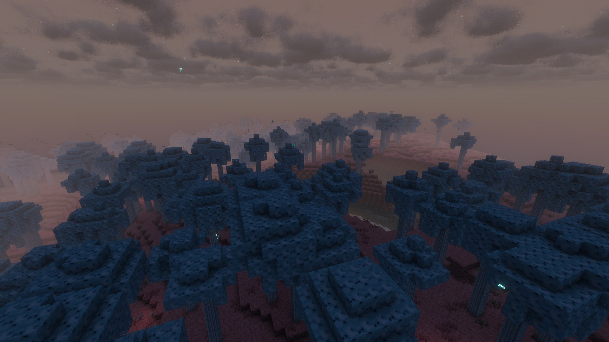
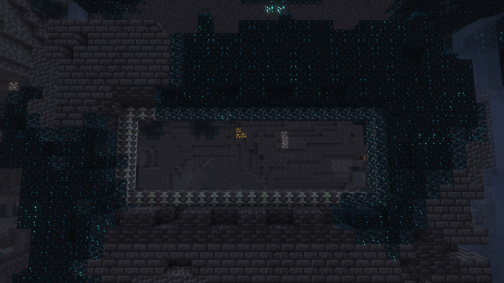
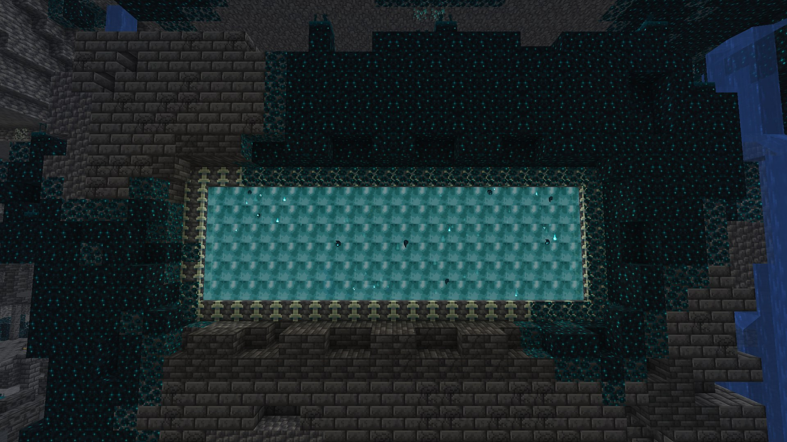
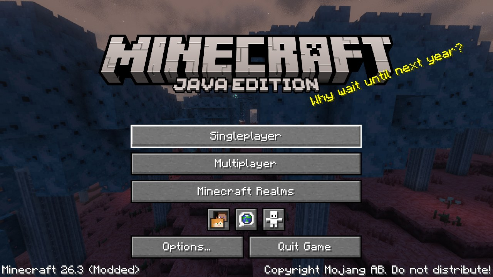

# The Sift Unbound

**An unofficial Fabric mod for Minecraft Java 26.3 that opens the ancient city's Warden Portal into _the Sift_.**



| The Warden Portal, dormant… | …and awakened |
|---|---|
|  |  |

Mojang revealed the Sift for *Minecraft Dungeons II* and announced it for Minecraft in 2027. This mod lets you visit it now:

* 🌀 **Warden Portal** – play the Sift's melody (F♯ A C♯ B A E C♯ F♯) on eight **note blocks** by the reinforced-deepslate
  frame in any ancient city, as in Dungeons II, or use an **Echo Tuner** crafted from echo shards.
* 🌸 **The Sift** – 6 regions: **Singer's Meadow**, the **Sifter Canyons**, the **Pallid Grove**, the **Ichor Ponds**, the
  **Humbler Huskland** and the **Lullaby Hills**, with soulshale monoliths, sculk formations and colossal humbler fossils.
* 🌊 **Ichor** – a thick, oily liquid that makes Overworlders **Soulsick**; the Sift's own creatures bathe in it.
* 🌗 **Tides** – **Flow**, **Endure** (no natural healing, stronger monsters) and **Thrive** (faster healing).
* 🐾 **Wildlife** – blubs, nuzzles, slabbers, echo golems and **the Singer** at the Singer's Portal.
* 🌿 **The Sifters** – seedlings, nesters, pollinators, sentinels and sprouts, the **Harmonizer** mini-boss, and enraging.
* 🦂 **Sculkers** – stalkers and scavengers, and **the Monarch** boss in its **sculker nest** in the Ravines.
* 🏆 26 advancements that explain each mechanic as you meet it; all-original textures, models, sounds and music.
* 🖼 A Sift **title screen**: a 360° panorama of the Lullaby Hills (shot in game with shaders) and Sift splash texts.



Everything (textures, models, sounds, music) is original and made for this project. See the **[GitHub Wiki](https://github.com/MilkdromedaStudios/Sift-Unbound/wiki)**.

## Install

1. Install [Fabric Loader](https://fabricmc.net/use/) ≥ 0.20.1 for **Minecraft 26.3**, plus [Fabric API](https://modrinth.com/mod/fabric-api).
2. Drop `sift-unbound-<version>+mc26.3.jar` (from [Releases](https://github.com/MilkdromedaStudios/Sift-Unbound/releases) or the
   `build` workflow's artifacts) into your `mods` folder. Java 25 is required, as for Minecraft 26.3.
3. The mod is needed on **both** the server and every client.

## How to get to the Sift

1. `/locate structure minecraft:ancient_city`, or explore the Deep Dark below Y 0. Collect **echo shards** from the chests.
2. Craft the **Echo Tuner**: 3 echo shards (top, left and right) around an **amethyst shard**, with a **note block** in the bottom-middle.
3. Use it on the big frame in the centre of the city, **or** put eight note blocks in front of the frame and play
   F♯ A C♯ B A E C♯ F♯ (note block clicks 12, 15, 19, 17, 15, 10, 7, 12). Sneak-use the tuner to hear the melody.
4. Step in and wait.

## Building from source

```bash
./gradlew build            # jar in build/libs/
```

```bash
./gradlew runGameTest      # server GameTests (portal on a real ancient-city frame, soul water, blubs...)
```

```bash
xvfb-run -a ./gradlew runClientGameTest   # client test: travels to the Sift and takes the wiki screenshots
```

Assets are generated by scripts in `tools/` (see [Art pipeline](wiki/Art-Pipeline.md)).

## Credits & legal

The Sift, the blub, sculk, the ancient city and Minecraft are © **Mojang Studios / Microsoft**. This mod is **not affiliated with or
endorsed by** them, and contains no Mojang assets. Sift facts come from the [Minecraft Wiki](https://minecraft.wiki) (CC BY-NC-SA 3.0).
Run `/sift credits` in game. Full credits: [CREDITS.md](CREDITS.md). Code and original assets: [Apache-2.0](LICENSE).
