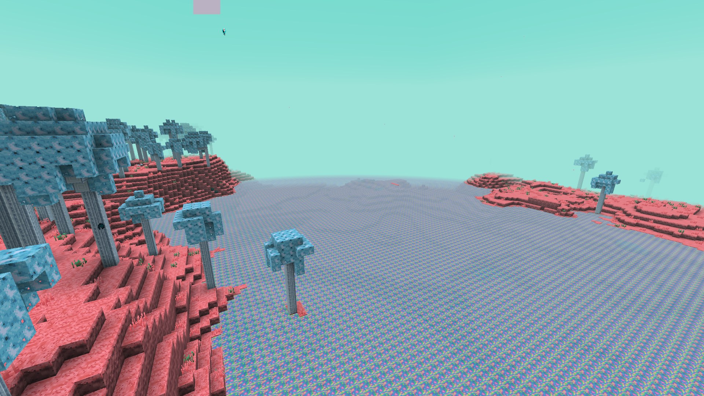
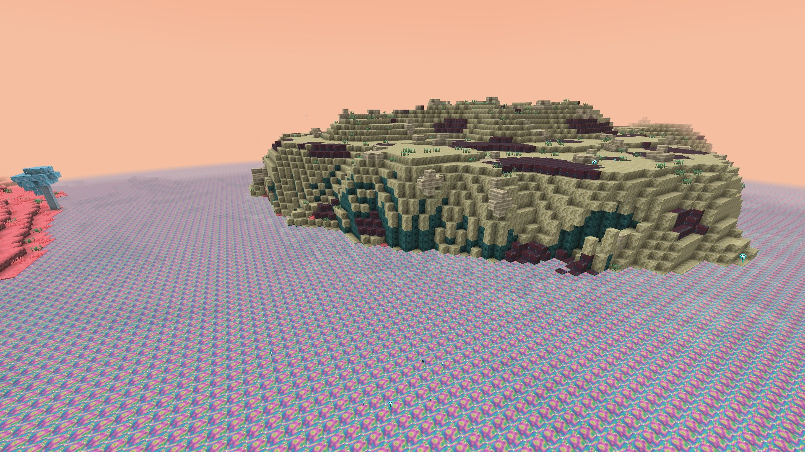
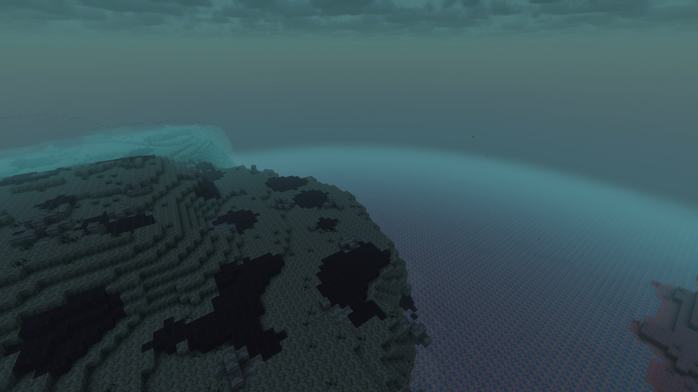
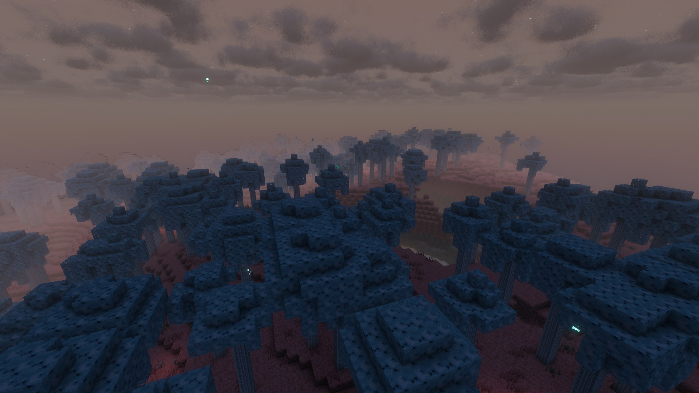
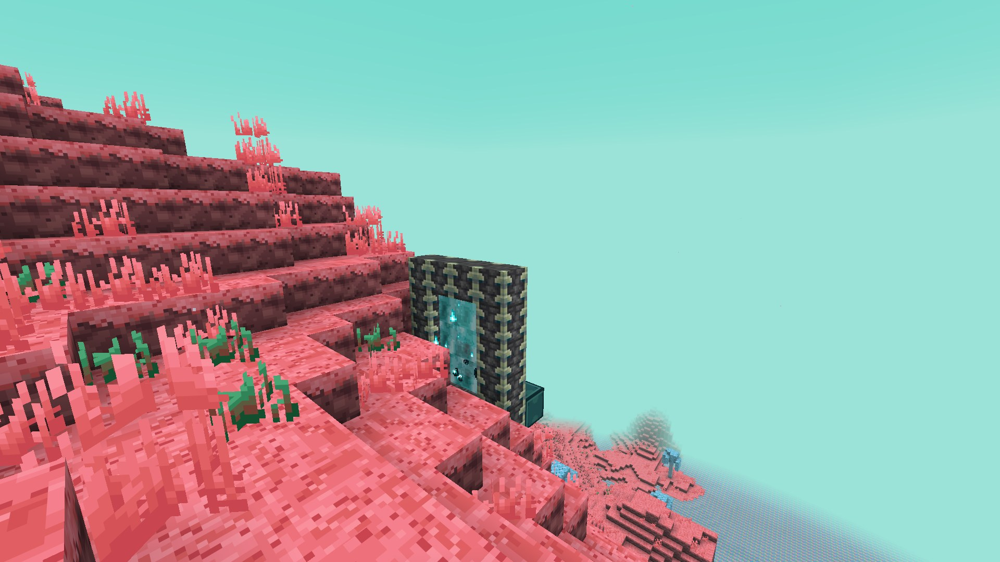
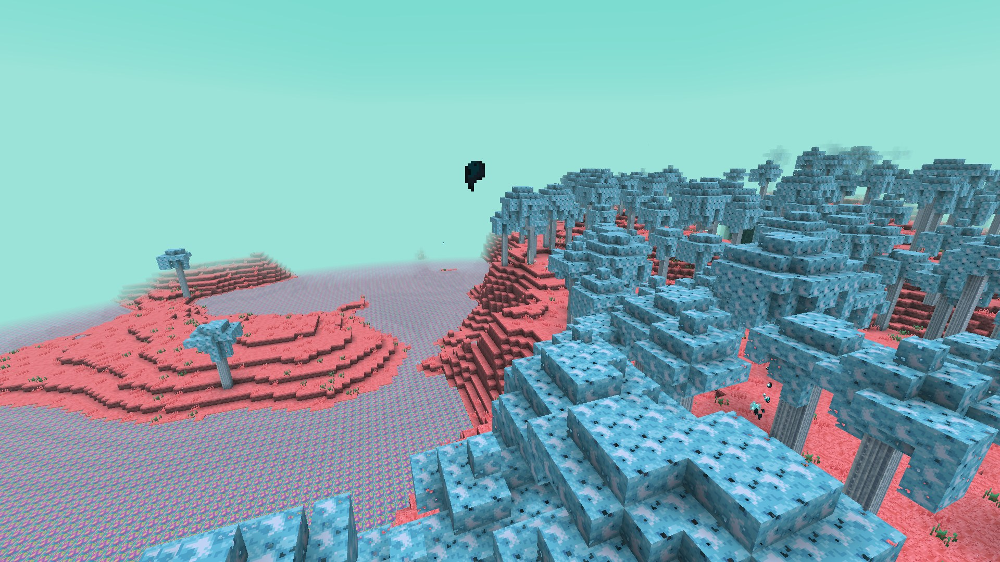
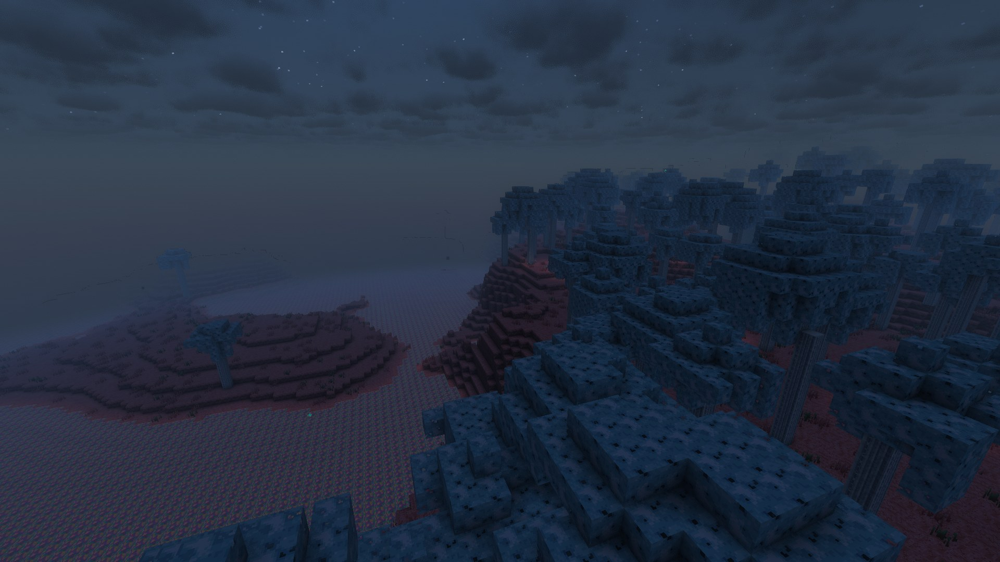
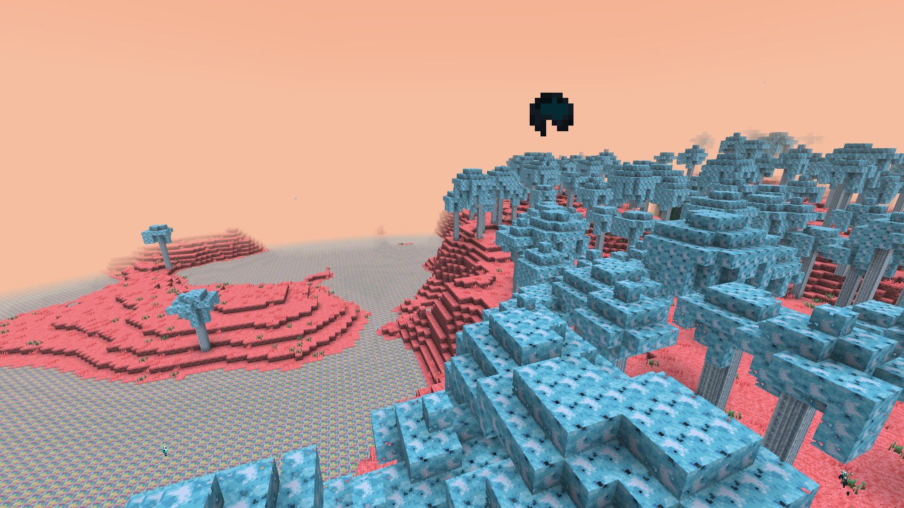

# Biomes & Tides

[Home](Home.md) · [The Sift (research)](The-Sift-Research.md) · [Warden Portal](Warden-Portal.md) · [Biomes & Tides](Biomes-and-Tides.md) · [Terrain](Terrain-Blocks.md) · [Soulshale](Soulshale.md) · [Plants](Plants.md) · [Pallid Wood](Pallid-Wood.md) · [Soul Water](Soul-Water.md) · [Mobs](Mobs.md) · [Items](Items.md) · [Advancements](Advancements.md) · [Sounds](Sounds.md) · [Art pipeline](Art-Pipeline.md) · [Credits](Credits.md)

The Sift (`sift_unbound:the_sift`) uses the Overworld's terrain shape (hills, caves, ravines), built from **Soulshale**, with **Ichor**
filling everything below **Y 52**. Height −64 to 320. Beds and respawn anchors don't work ("the tides of the Sift keep you awake").
White ash drifts through the air (the "particles in the sky" seen in Dungeons II). Region names are the official ones.

| Region (biome ID) | Surface | Features | Creatures |
|---|---|---|---|
| **Singer's Meadow** (`sift_meadows`) | Sift Grass Block over Sift Soil | Sift grass, Lullaby Blooms, Teal Sprouts, a few Pallid trees, **soulshale monoliths** | Blubs, nuzzles, slabbers, echo golems; sifters; stalkers at Endure |
| **Sifter Canyons** (`sifter_canyons`) | Sift Grass | Deep, frequent canyons; **sifter nests** | Sifters everywhere (a Harmonizer now and then) |
| **Pallid Grove** (`pallid_grove`) | Sift Grass | Dense Pallid trees; rare monoliths and sculk formations; sculk-soul motes | Blubs, wisps, a few sifters |
| **Ichor Ponds** (`soul_wetlands`) | Sift Grass / soil | Many ichor pools; rare sculk formations; floating souls | Blubs bathing, slabbers, pollinators and sprouts |
| **Humbler Huskland** (`husklands`) | **Sift Sand** | Husk Shell boulders, dark sculk, **sculk formations**, **humbler husk** fossils (rib cages, carapaces, skulls) | Carapace blubs, stalkers, **scavengers**, seedlings |
| **Lullaby Hills** (`lullaby_hills`) | **Sift Sculk** (red) | Teal Sprouts, Lullaby Blooms, soulshale monoliths | Blubs, nuzzles, echo golems; sifters |

Every region also has Soul Shard ore, ichor springs and rare ichor lakes. **Sculker nests** lie deep under Singer's
Meadow, the Sifter Canyons, the Humbler Huskland and the Lullaby Hills: look for a soulshale doorway in a hillside, or
`/locate structure sift_unbound:sculker_nest`. The **Monarch** waits in the cavern below, beside a chest on an obsidian plinth.

| Singer's Meadow | Pallid Grove | Ichor Ponds |
|---|---|---|
|  |  |  |
| **Humbler Huskland** | **Lullaby Hills** | **Arriving through a portal** |
|  |  |  |

*Screenshots from the photo shoot (`./gradlew runClientGameTest -Pphotoshoot`, HUD hidden). Every CI run also uploads fresh ones from the client GameTest as artifacts.*

## Tides

The Sift has no sun or moon. Its 20-minute day is split into three tides (names from *Minecraft Dungeons II*):

| Tide | Day time | Sky | What changes |
|---|---|---|---|
| **Flow** | 0 – 8000 | Teal (`#60d5c8`, the colour of the reveal) | Calm and bright. |
| **Endure** | 8000 – 16000 | Deep night-blue, stars ("sky particles") | Wounds don't mend on their own; monsters that spawn are stronger; stalkers come out on the surface; slabbers sleep. |
| **Thrive** | 16000 – 24000 | Warm salmon-gold | Wounds mend 50 % faster. |

Run `/sift tide` to see the current tide. The colours fade over 1200 ticks between tides. The cycle lives in the data-driven
timeline `data/sift_unbound/timeline/sift_tides.json`, so datapacks can retune it.

| Flow | Endure | Thrive |
|---|---|---|
|  |  |  |
