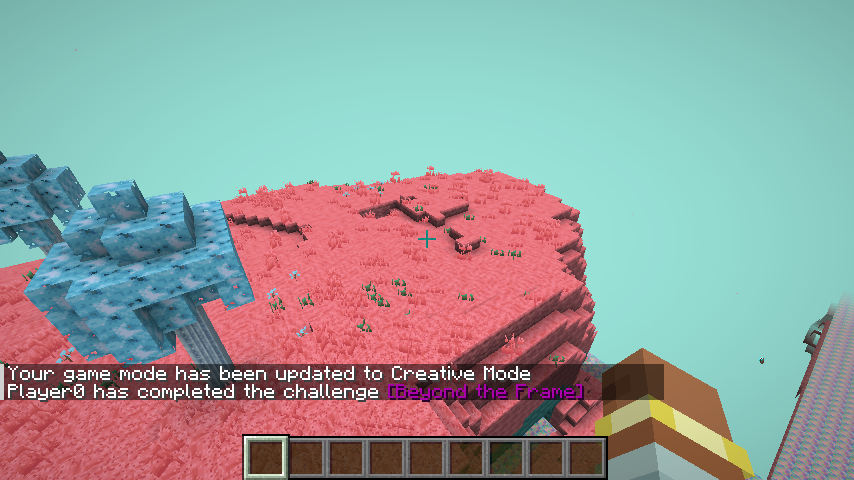
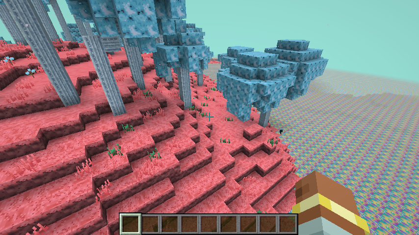
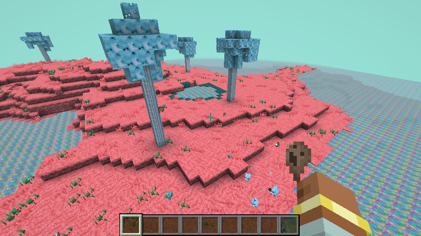
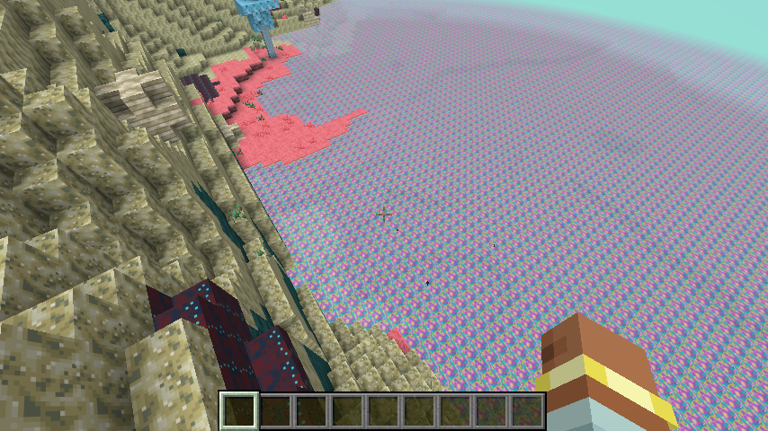
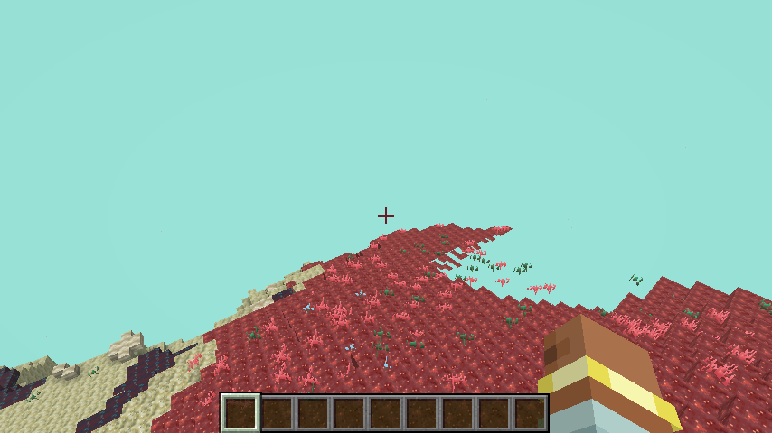
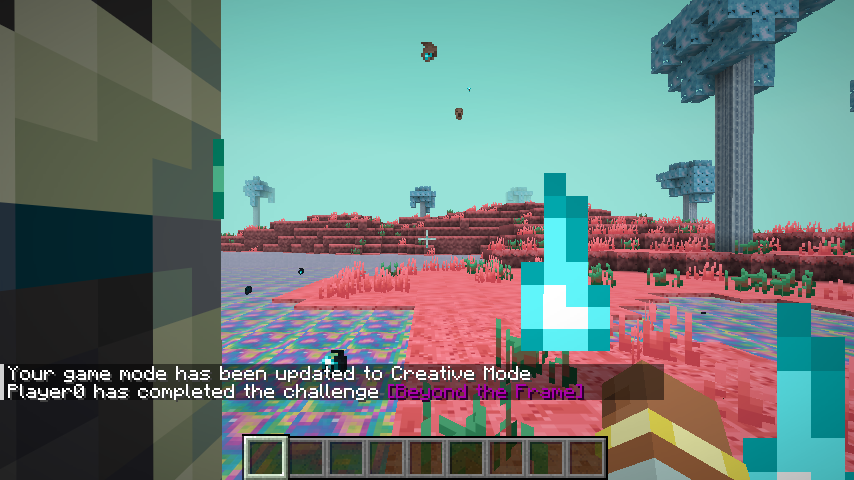
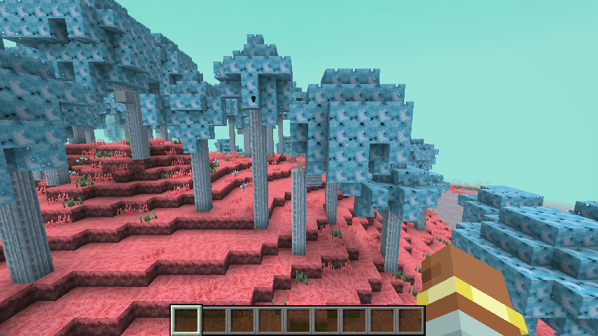
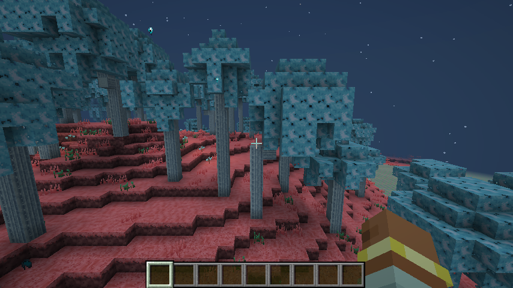
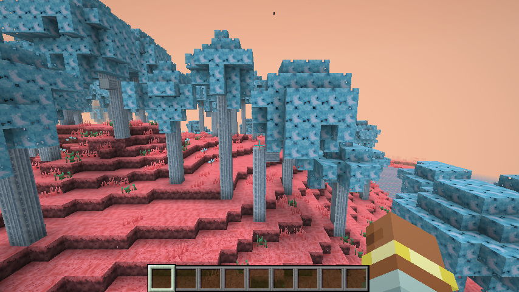

# Biomes & Tides

[Home](Home.md) · [The Sift (research)](The-Sift-Research.md) · [Warden Portal](Warden-Portal.md) · [Biomes & Tides](Biomes-and-Tides.md) · [Terrain](Terrain-Blocks.md) · [Soulshale](Soulshale.md) · [Plants](Plants.md) · [Pallid Wood](Pallid-Wood.md) · [Soul Water](Soul-Water.md) · [Mobs](Mobs.md) · [Items](Items.md) · [Advancements](Advancements.md) · [Sounds](Sounds.md) · [Art pipeline](Art-Pipeline.md) · [Credits](Credits.md)

The Sift (`sift_unbound:the_sift`) uses the Overworld's terrain shape (hills, caves, ravines), built from **Soulshale**, with **Soul Water**
filling everything below **Y 52**. Height −64 to 320. Beds and respawn anchors don't work ("the tides of the Sift keep you awake").
White ash drifts through the air (the "particles in the sky" seen in Dungeons II).

| Biome | Surface | Features | Creatures |
|---|---|---|---|
| **Sift Meadows** | Sift Grass Block over Sift Soil | short & tall Sift grass, Lullaby Blooms, Teal Sprouts, a few Pallid trees | Blubs (2–4), Soul Wisps, Sculk Prowlers |
| **Pallid Grove** | Sift Grass | dense Pallid trees + tall branching Pallid trees, Sift grass, flowers; sculk-soul motes | Lots of Blubs, Soul Wisps |
| **Soul Wetlands** | Sift Grass / soil | many Soul Water pools, Teal Sprouts, a few trees; floating souls | Blubs bathing (3–6), many Soul Wisps |
| **Husklands** | **Sift Sand** | Husk Shell boulders, Dark Sift Sculk patches | Carapace blubs, extra Sculk Prowlers |
| **Lullaby Hills** | **Sift Sculk** (red) | Teal Sprouts, Lullaby Blooms | Blubs, Prowlers |

Every biome also has Soul Shard ore, Soul Water springs and rare Soul Water lakes.

| Sift Meadows | Pallid Grove | Soul Wetlands |
|---|---|---|
|  |  |  |
| **Husklands** | **Lullaby Hills** | **Arriving through a portal** |
|  |  |  |

*Screenshots are taken automatically by the client GameTest (`SiftClientGameTest`) on every CI run.*

## Tides

The Sift has no sun or moon. Its 20-minute day is split into three tides (names from *Minecraft Dungeons II*):

| Tide | Day time | Sky | What changes |
|---|---|---|---|
| **Flow** | 0 – 8000 | Teal (`#60d5c8`, the colour of the reveal) | Calm and bright. |
| **Endure** | 8000 – 16000 | Deep night-blue, stars ("sky particles") | Sky light drops to 30 %, so **Sculk Prowlers** can spawn on the surface. |
| **Thrive** | 16000 – 24000 | Warm salmon-gold | Bright again. |

Run `/sift tide` to see the current tide. The colours fade over 1200 ticks between tides. The cycle lives in the data-driven
timeline `data/sift_unbound/timeline/sift_tides.json`, so datapacks can retune it.

| Flow | Endure | Thrive |
|---|---|---|
|  |  |  |
