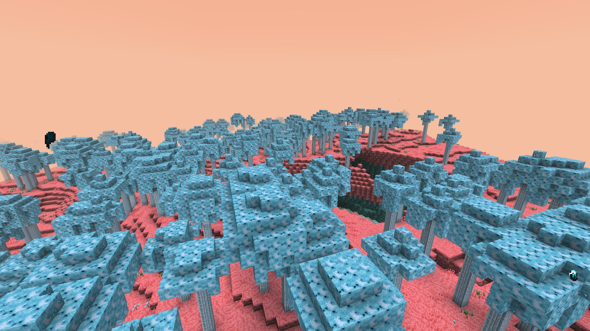

# The Sift Unbound – wiki

[Home](Home.md) · [The Sift (research)](The-Sift-Research.md) · [Warden Portal](Warden-Portal.md) · [Biomes & Tides](Biomes-and-Tides.md) · [Terrain](Terrain-Blocks.md) · [Soulshale](Soulshale.md) · [Plants](Plants.md) · [Pallid Wood](Pallid-Wood.md) · [Soul Water](Soul-Water.md) · [Mobs](Mobs.md) · [Items](Items.md) · [Advancements](Advancements.md) · [Sounds](Sounds.md) · [Art pipeline](Art-Pipeline.md) · [Credits](Credits.md)

**The Sift Unbound** is an unofficial Fabric mod for **Minecraft Java 26.3** that lets you awaken the **Warden Portal** at the heart of
every ancient city and travel to **the Sift** – the dimension Mojang revealed for *Minecraft Dungeons II* and announced for
Minecraft in 2027. Everything in the mod (textures, models, sounds, music) is original; see [Credits](Credits.md).

## Quick start

1. Find an **ancient city** in the Deep Dark (`/locate structure minecraft:ancient_city`). Loot its chests for **echo shards**.
2. Craft an **[Echo Tuner](Items.md#echo-tuner)**: 3 echo shards (top, left, right) around an amethyst shard, with a note block underneath.
3. Use the tuner on the big **reinforced deepslate frame** in the middle of the city. The frame fills with a shimmering portal.
4. Step in (4 seconds in survival). You arrive in **the Sift**, next to a small return portal.
5. Don't swim in the rainbow **[Soul Water](Soul-Water.md)** – it makes you *Soulsick* and drains your health (and XP).
6. Make friends with **[blubs](Mobs.md#blub)** (they love Lullaby Blooms), watch for **[Sculk Prowlers](Mobs.md#sculk-prowler)** during the dark *Endure Tide*.

## Everything in the mod

| Category | Count | Pages |
|---|---|---|
| Dimension | 1 (the Sift, 5 biomes, 3 tides) | [Biomes & Tides](Biomes-and-Tides.md) |
| Blocks | 45 | [Terrain](Terrain-Blocks.md), [Soulshale](Soulshale.md), [Plants](Plants.md), [Pallid Wood](Pallid-Wood.md), [Soul Water](Soul-Water.md), [Warden Portal](Warden-Portal.md) |
| Items | 8 (+ 38 block items) | [Items](Items.md) |
| Mobs | 3 (Blub ×3 looks, Soul Wisp, Sculk Prowler) | [Mobs](Mobs.md) |
| Status effects | 1 (Soulsick) | [Soul Water](Soul-Water.md#soulsick) |
| Advancements | 7 | [Advancements](Advancements.md) |
| Sounds | 19 events / 28 original sound files | [Sounds](Sounds.md) |
| Commands | `/sift credits`, `/sift tide` | below |

## Commands

* `/sift credits` – shows the credits and the "not affiliated with Mojang" notice.
* `/sift tide` – tells you whether the Sift is in its Flow, Endure or Thrive tide.

## For developers

* Build: `./gradlew build` (Java 25). Tests: `./gradlew runGameTest` (server) and `xvfb-run ./gradlew runClientGameTest` (client, takes the screenshots on these pages).
* Beauty shots: `tools/photoshoot.sh` (with shaders) or `./gradlew runClientGameTest -Pphotoshoot` (vanilla renderer); trailer: `python3 tools/make_trailer.py <shots> <music.mp3> out.mp4`.
* Assets are generated: `python3 tools/texture_pipeline/gen_textures.py`, `python3 tools/gen_sounds.py`, `python3 tools/gen_assets.py --vanilla <extracted 26.3 jar>`, `python3 tools/gen_wiki.py`. See [Art pipeline](Art-Pipeline.md).
