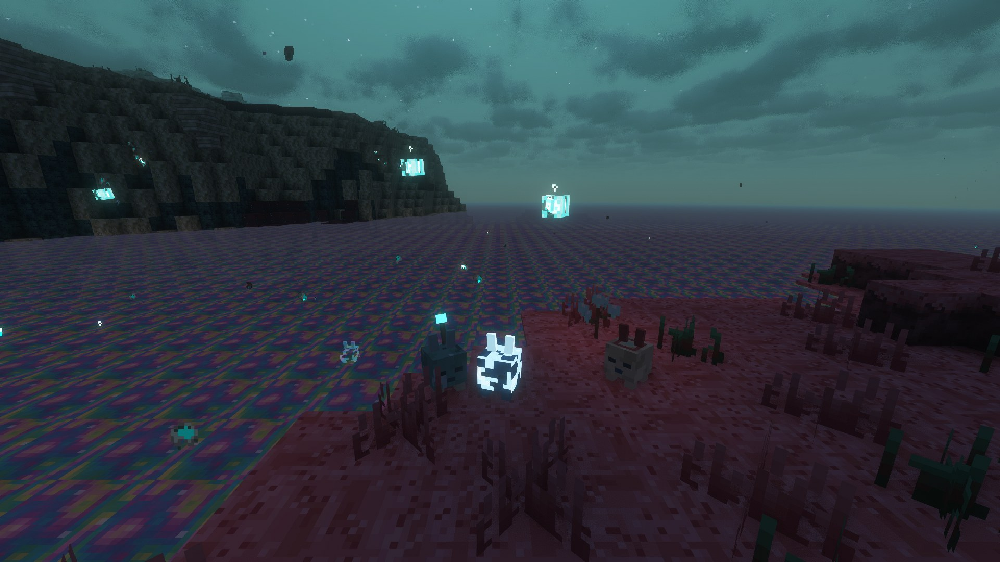

# Mobs

[Home](Home.md) · [The Sift (research)](The-Sift-Research.md) · [Warden Portal](Warden-Portal.md) · [Biomes & Tides](Biomes-and-Tides.md) · [Terrain](Terrain-Blocks.md) · [Soulshale](Soulshale.md) · [Plants](Plants.md) · [Pallid Wood](Pallid-Wood.md) · [Soul Water](Soul-Water.md) · [Mobs](Mobs.md) · [Items](Items.md) · [Advancements](Advancements.md) · [Sounds](Sounds.md) · [Art pipeline](Art-Pipeline.md) · [Credits](Credits.md)

## Blub

The Sift's signature creature, announced by Mojang for Minecraft in 2027: a small, squishy, rabbit-like jelly cube that hops around
and **squeaks every few seconds**. This model, its textures and sounds are original.

| Property | Value |
|---|---|
| ID | `sift_unbound:blub` (category: creature) |
| Health | 6 (3 ♥) |
| Size | 0.55 × 0.55 |
| Looks | **Soul-engorged** (glowing light blue, default), **Meadows** (mossy green with an antenna light), **Carapace** (beige shell with red frills – spawns on sand / dark sculk) |
| Spawns | On Sift ground or in Soul Water, groups of 1–6, any light level |
| Behaviour | Wanders and hops, panics when hurt, follows players holding **Lullaby Blooms** or **Teal Sprouts**, babies follow parents |
| Breeding | Lullaby Bloom or Teal Sprouts; babies take a parent's look |
| Soul Water | Immune; swims and never drowns |
| Bucket | Use a **Soul Water Bucket** on it to get a **Bucket of Blub** (keeps look, name, health, age) |
| Drops | 0–1 **Blub Jelly** (+Looting) |

## Soul Wisp

A harmless little soul that drifts out of soul water and ravines. Ambient like a bat: it floats about 1.5–9 blocks above the
ground, chimes softly, glows and leaves a trail of soul particles.

| Property | Value |
|---|---|
| ID | `sift_unbound:soul_wisp` (category: ambient) |
| Health | 4 |
| Flying | yes (no gravity, no fall damage) |
| Spawns | Every Sift biome, most in Soul Wetlands |
| Drops | nothing |

## Stalker

The clawed melee sculker of Minecraft Dungeons II: low, four-legged, with twitching sensor tendrils and glowing cyan veins
(registered as `sift_unbound:sculk_prowler`, its name before 0.3.0, so existing worlds keep theirs).

| Property | Value |
|---|---|
| ID | `sift_unbound:sculk_prowler` (category: monster) |
| Health / Armour | 30 / 2 |
| Attack | 5 damage + Soulsick 4 s, then a second claw strike a moment later |
| Lunge | From 4–10 blocks away it leaps at its target, leaving a trail of souls |
| Spawns | In the dark, plus on Sift ground below light 4 (so on the surface during the **Endure Tide**). Those spawned during the Endure Tide are stronger. |
| Hunts | Players and **sifters** |
| Drops | 0–2 Soul Shards, sometimes an echo shard, 8 XP |

## Scavenger

The yellowish, magical sculker, second largest of them, its torso an open cage of ribs around a glowing soul.

| Property | Value |
|---|---|
| ID | `sift_unbound:scavenger` (category: monster) |
| Health / Armour | 24 / 2 |
| Soul bolts | Its hands ignite and it hurls two bolts that chase their target and burst into a **pool of soulsickness** |
| Dodge | Get within 4 blocks and it dashes backwards, leaving golden afterimages |
| Spawns | Humbler Huskland (in the dark), sculker nests; summoned by the Monarch |
| Drops | 0–2 Soul Shards, sometimes an echo shard |

## The Monarch

The huge, long-clawed sculker boss that rules the **sculker nests** in the Ravines. A crown of sculk horns, a mantle of
feathers, very long arms. It has a boss bar.

| Property | Value |
|---|---|
| ID | `sift_unbound:monarch` (category: monster) |
| Health / Armour | 300 / 10 |
| Melee | 9 damage, and **every hit it lands heals it** |
| Heel stomp | Up close: a short twirl that hits everything around it |
| Summon | A roar that calls 2 stalkers and 2 scavengers (not again while they live) |
| Dash strike | A lunging slash; feathers form along its path and fly at you 5 seconds later |
| Hover loop | It spins at you; 8 feathers form in a circle and fly in 5 seconds later |
| Monarch Echo | Below 75 % health a spectral clone (60 health) joins in. Kill it and another forms later; it fades when the Monarch dies |
| Drops | 3–6 echo shards, 8–16 Soul Shards, 4–8 **Monarch Feathers** |

## The Sifters

The Sift's plant-like natives: wild creatures living in nests, driven mad by the illager invasion. They attack on sight,
in any light, and fight as a band (hurt one and those nearby join in). Killing a **Sprout** or a **Harmonizer**
**enrages** every sifter within 16 blocks for good: +30 % speed, +50 % damage, +50 % health, glowing purple details,
and they go for the killer. Sifters are at home in ichor; the sculkers hunt them.

| Sifter | Health | What it does | Drops |
|---|---|---|---|
| **Seedling** | 12 | Small and quick; scurries up, lunges and bites. Catches and eats one arrow in five. | Teal Sprouts |
| **Nester** | 26 | Tall, stilt-legged, a nest on its back; gallops in, lunges and bites, dodges one melee blow in four. | Sticks, Teal Sprouts |
| **Pollinator** | 18 | Frog-like; keeps its distance, puffs its throat and spits **pollen globs** that stick and burst into slowing yellow goo; tongue lash up close. | Pollen Globs |
| **Sentinel** | 18 | Bearded and crested; shakes its head, then fires three **quills** that home for half a second, then fly straight. Rests afterwards. | Sentinel Quills |
| **Sprout** | 16 | Squid-like, floating; glows turquoise when roused. **Life Link**: a beam that makes an ally (pollinators first) faster, stronger, tougher and quick to heal, until you hit the sprout. Whips with its tendrils. | Soul Shard, Lullaby Bloom |
| **Harmonizer** | 150 | Rare mini-boss (boss bar), a massive sprout: a **roar** shockwave that calls a band of sifters it strengthens through beams, a tentacle slap, and a **vortex** that drags in anyone on the ground (keep jumping) before it slams down. | Soul Shards, Lullaby Blooms, Quills |

They spawn in Singer's Meadow, the Lullaby Hills, the Pallid Grove and the Ichor Ponds, and swarm the **Sifter Canyons**.

## Wildlife

| Creature | What it does |
|---|---|
| **Nuzzle** | Sheep-like grazer of Singer's Meadow. Shear it for pink wool; the fleece grows back when it grazes Sift grass. Bred with Sift grass. |
| **Slabber** | Slow, armoured, turtle-like, its shell a slab of mossy soulshale. Sleeps through the Endure Tide (the night elsewhere), tucked in like part of the ground. Bred with Teal Sprouts. |
| **Echo Golem** | The Sift's caretaker, powered by the soul block on its head; runs down and recharges by bathing in ichor. Hand it an Echo Shard near a dormant Warden Portal and it plays the melody and wakes it. |
| **The Singer** | A healthy warden, keeper of the Singer's Portal. Can't be hurt; sings the Sift's melody (right-click it) and creates echo golems. |
