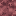
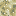
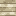
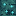

# Terrain blocks

[Home](Home.md) · [The Sift (research)](The-Sift-Research.md) · [Warden Portal](Warden-Portal.md) · [Biomes & Tides](Biomes-and-Tides.md) · [Terrain](Terrain-Blocks.md) · [Soulshale](Soulshale.md) · [Plants](Plants.md) · [Pallid Wood](Pallid-Wood.md) · [Soul Water](Soul-Water.md) · [Mobs](Mobs.md) · [Items](Items.md) · [Advancements](Advancements.md) · [Sounds](Sounds.md) · [Art pipeline](Art-Pipeline.md) · [Credits](Credits.md)

| | Block |
|---|---|
|  | [Sift Grass Block](#sift-grass-block) |
|  | [Sift Soil](#sift-soil) |
|  | [Sift Sculk](#sift-sculk) |
|  | [Dark Sift Sculk](#dark-sift-sculk) |
|  | [Sift Sand](#sift-sand) |
|  | [Husk Shell](#husk-shell) |
|  | [Soul Shard Ore](#soul-shard-ore) |

### Sift Grass Block

The soft salmon-pink grass that carpets the Sift - the colour shown in Mojang's Minecraft LIVE reveal. Spreads onto nearby Sift Soil in light, turns back into soil when covered, and sprouts Sift plants when bone-mealed. Blubs and Sculk Prowlers spawn on it.

| Property | Value |
|---|---|
| ID | `sift_unbound:sift_grass_block` |
| Hardness | 0.6 |
| Best tool | Shovel |
| Where to find | Surface of Sift Meadows, Pallid Grove and Soul Wetlands |
| Drops | Sift Grass Block, Sift Soil (itself with Silk Touch) |
| Tags | `#minecraft:animals_spawnable_on`, `#minecraft:blocks_motion_no_leaves`, `#minecraft:mineable/shovel`, `#minecraft:overworld_carver_replaceables`, `#minecraft:supports_vegetation`, `#sift_unbound:sift_ground` |

### Sift Soil

Dusky rose earth. Sift grass spreads onto it; trees and plants grow on it.

| Property | Value |
|---|---|
| ID | `sift_unbound:sift_soil` |
| Hardness | 0.5 |
| Best tool | Shovel |
| Where to find | Under the grass of most Sift biomes |
| Drops | Sift Soil |
| Tags | `#minecraft:animals_spawnable_on`, `#minecraft:blocks_motion_no_leaves`, `#minecraft:mineable/shovel`, `#minecraft:overworld_carver_replaceables`, `#minecraft:supports_vegetation`, `#sift_unbound:sift_ground` |

### Sift Sculk

The red, 'healthy' sculk that covers the Sift's hills. In Minecraft Dungeons II the Sift is the original home of sculk; this block is the mod's take on that red living ground. Glows very faintly.

| Property | Value |
|---|---|
| ID | `sift_unbound:sift_sculk` |
| Hardness | 0.6 |
| Best tool | Hoe |
| Light level | 1 |
| Where to find | Surface of the Lullaby Hills |
| Drops | Sift Sculk |
| Tags | `#minecraft:animals_spawnable_on`, `#minecraft:blocks_motion_no_leaves`, `#minecraft:mineable/hoe`, `#minecraft:mineable/pickaxe`, `#minecraft:overworld_carver_replaceables`, `#minecraft:supports_vegetation`, `#sift_unbound:sift_ground` |

### Dark Sift Sculk

Darker, starved sculk with cyan sparks, found in patches across the sandy Husklands.

| Property | Value |
|---|---|
| ID | `sift_unbound:dark_sift_sculk` |
| Hardness | 0.6 |
| Best tool | Hoe |
| Light level | 2 |
| Where to find | Patches in the Husklands |
| Drops | Dark Sift Sculk |
| Tags | `#minecraft:animals_spawnable_on`, `#minecraft:blocks_motion_no_leaves`, `#minecraft:mineable/hoe`, `#minecraft:mineable/pickaxe`, `#minecraft:overworld_carver_replaceables`, `#sift_unbound:sift_ground` |

### Sift Sand

Pale, sun-bleached sand. Falls like sand and smelts into glass. Carapace blubs spawn on it.

| Property | Value |
|---|---|
| ID | `sift_unbound:sift_sand` |
| Hardness | 0.5 |
| Best tool | Shovel |
| Where to find | Surface of the Husklands |
| Drops | Sift Sand |
| Tags | `#minecraft:animals_spawnable_on`, `#minecraft:blocks_motion_no_leaves`, `#minecraft:mineable/shovel`, `#minecraft:overworld_carver_replaceables`, `#minecraft:sand`, `#minecraft:supports_vegetation`, `#sift_unbound:sift_ground` |

**Used to make**: Glass

### Husk Shell

Layered, bone-like plates - the remains of giant husks that dot the Husklands. Placed like a log (it has an axis). Craft one into 6 bone meal.

| Property | Value |
|---|---|
| ID | `sift_unbound:husk_shell` |
| Hardness | 2 |
| Best tool | Pickaxe |
| Where to find | Boulders scattered across the Husklands |
| Drops | Husk Shell |
| Tags | `#minecraft:blocks_motion_no_leaves`, `#minecraft:mineable/pickaxe`, `#minecraft:overworld_carver_replaceables` |

**Used to make**: Bone Meal

### Soul Shard Ore

Soulshale threaded with crystallised souls. Drops 1-2 Soul Shards (Fortune works) and 2-5 XP.

| Property | Value |
|---|---|
| ID | `sift_unbound:soul_shard_ore` |
| Hardness | 4 |
| Blast resistance | 6 |
| Best tool | Pickaxe (stone+) |
| Light level | 4 |
| Where to find | Inside Soulshale, Y -48 to 80, 14 veins per chunk |
| Drops | Soul Shard, Soul Shard Ore (itself with Silk Touch) |
| Tags | `#minecraft:blocks_motion_no_leaves`, `#minecraft:mineable/pickaxe`, `#minecraft:needs_stone_tool` |
