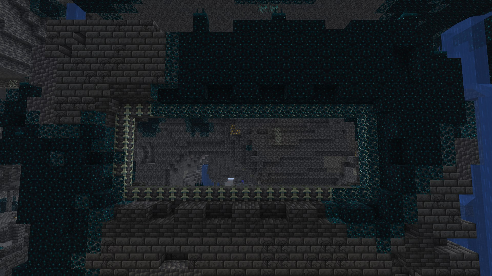
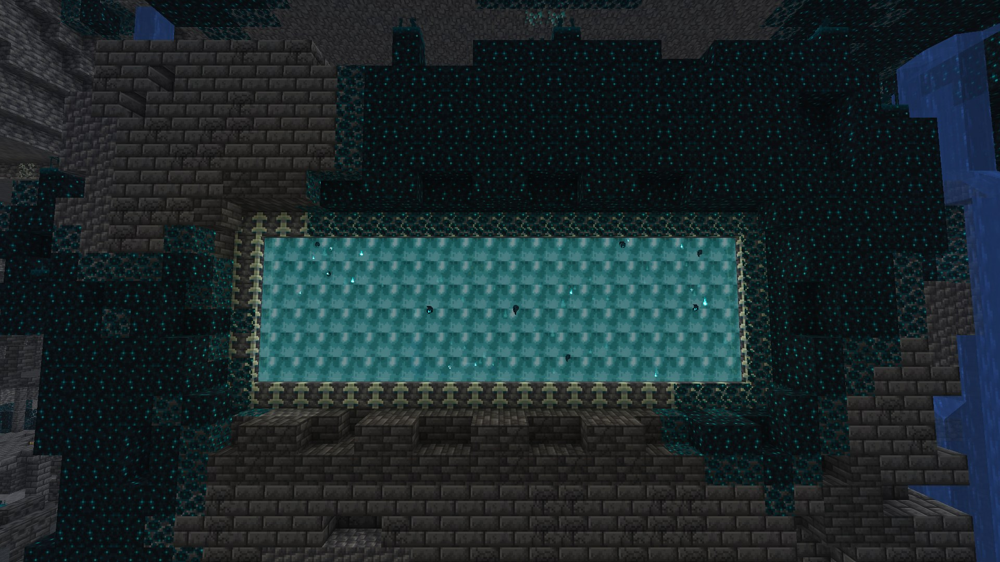
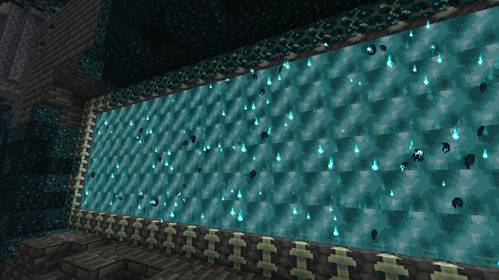

# The Warden Portal

[Home](Home.md) · [The Sift (research)](The-Sift-Research.md) · [Warden Portal](Warden-Portal.md) · [Biomes & Tides](Biomes-and-Tides.md) · [Terrain](Terrain-Blocks.md) · [Soulshale](Soulshale.md) · [Plants](Plants.md) · [Pallid Wood](Pallid-Wood.md) · [Soul Water](Soul-Water.md) · [Mobs](Mobs.md) · [Items](Items.md) · [Advancements](Advancements.md) · [Sounds](Sounds.md) · [Art pipeline](Art-Pipeline.md) · [Credits](Credits.md)

| Dormant | Awakened |
|---|---|
|  |  |

In vanilla Minecraft the ancient city has a huge, empty **reinforced deepslate frame** in its centre. Mojang confirmed in 2026
that it is a portal to the Sift. In *Minecraft Dungeons II* it is woken by a note block machine. In this mod you wake it with an
**Echo Tuner**.

## Awakening it

* Hold an **Echo Tuner** and use it on the frame (any frame block) or on a block inside the opening.
* The mod looks for a **complete rectangle of reinforced deepslate** in either direction around that spot. The opening can be from
  **2×3 up to 23×23**. The ancient city frame has a **20×6** opening (22×8 outside).
* Anything left inside the opening (sculk, deepslate rubble, plants) is cleared, as long as it is breakable and not a block entity.
* The opening fills with **Sift Portal** blocks, you hear a chime arpeggio, and the tuner loses 1 durability.
* If there's no complete frame, the tuner plays a low note and tells you so.
* Reinforced deepslate can't be obtained in survival, so in practice only ancient-city frames can be awakened. In creative you can
  build your own frames.

## Travelling

| | Overworld → Sift | Sift → Overworld |
|---|---|---|
| Delay | Same as nether portals (4 s survival, instant creative; uses the `players_nether_portal_*_delay` game rules) | same |
| Coordinates | 1 : 1 (no scaling) | 1 : 1 |
| Destination | Nearest Sift portal within 64 blocks, otherwise a new **2×3 return portal** is built on the surface | Nearest Sift portal within 64 blocks (usually the ancient city frame you came through), otherwise a new portal on the surface |
| Effect | Nausea-style warp, travel sound | same |

* Return portals are framed with reinforced deepslate and stand on a **Polished Soulshale** platform (in the Overworld, polished deepslate).
* Breaking a frame block makes the whole membrane collapse.
* Mobs and items can use the portal too (not the Sift's own creatures if they don't wander in).

## Technical

| Block | ID | Light | Notes |
|---|---|---|---|
| Sift Portal | `sift_unbound:sift_portal` | 12 | `axis` = x / z, unbreakable, point of interest `sift_unbound:sift_portal` (used to link portals) |
| Frame | tag `#sift_unbound:warden_portal_frame` | – | contains `minecraft:reinforced_deepslate`; datapacks can add more frame blocks |
